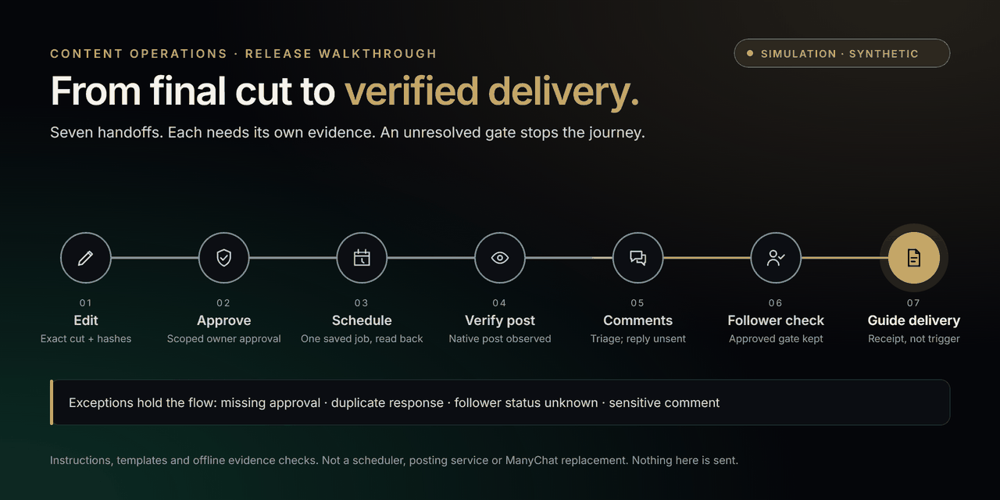

<div align="center">

# Content Operations
**Approved content. Verified delivery. Accountable follow-through.**

Portable instructions and offline evidence checks for social-content workflows.

**MIT preview · Bounded Claude / ChatGPT Work checks · No live deployment**
</div>

[](docs/walkthrough/README.md)

[Interactive walkthrough HTML](docs/walkthrough/index.html) · [How to open it and review status](docs/walkthrough/README.md) · [Conceptual animation (GIF)](assets/walkthrough-preview.gif)

**Simulation, not a service.** Open the HTML file on GitHub, choose **Download raw file**, then open it locally; GitHub cannot run it inline. It plays the seven stages once when motion is allowed, offers Previous, Play/Pause, Next and Reset, lets you select any stage, and holds four exception paths at their gate. Nothing is hosted, connected or sent. The images and GIF are conceptual artwork, not a browser recording. Scoped Chromium checks were reviewer-reported; raw browser receipts were unavailable for independent inspection. Reduced-motion runtime, screen-reader and non-Chromium checks remain untested.

## What this is
A Markdown skill, synthetic templates, read-only tracker adaptation and evidence validators. It is not a posting bot, connector, background scheduler or permission to act. Scheduling, comment replies and guide delivery require separately authorized services and current evidence.

| Prepare | Release | Follow through |
| --- | --- | --- |
| Bind approvals to final files and rights-cleared assets. | Verify the intended account, posting instant and actual post. | Verify exact delivery routes, authorized coverage and receipts. |

Unknown evidence blocks readiness. One service owner and one scheduler per release; no blind retries or invented receipts.

## Quick local evaluation
Requires Python 3.10+ for optional helpers; no third-party Python packages or network access needed.

```sh
python scripts/validate_repository.py
python scripts/package.py --target claude --out build/content-operations-claude.zip
python scripts/package.py --target codex --out build/content-operations-codex.zip
python scripts/package.py --target openai --out build/content-operations-openai.zip
python scripts/package.py --target gemini --out build/content-operations-gemini.zip
```

Read [setup](docs/SETUP.md) before installing. Build output must not already exist. Packaging is not host import or runtime certification.

## Host evidence matrix
**The preview archives passed bounded synthetic checks in Claude Code, Claude web and ChatGPT Work.** This confirms the tested offline workflow only. [Host support](docs/HOST_SUPPORT.md) records exact archive hashes and evidence limits; import alone is not a pass.

| Tested surface | Current archives | Evidence limit |
| --- | --- | --- |
| Claude web, native skill | PASS, bounded synthetic checks | Expanded tool responses; documented invocation correction, no whole-import comparison |
| Claude Code, session-only plugin | PASS, bounded synthetic checks | Actual tool stream; 23 package members and inputs unchanged |
| Claude Desktop app | NOT RUN for skill acceptance | Desktop walkthrough preview checks do not establish native skill/runtime acceptance |
| ChatGPT Work web, standalone skill | PASS, bounded conversation-reported checks | Native replacement/invocation; 14 expected exits and matching core/input hashes; no raw tool transcript |
| Codex CLI | BLOCKED | Earlier first skill-file read denied by execution policy; not retried |
| Gemini Apps | BLOCKED | Predecessor imported; no verified execution of current bytes |

The current Claude and ChatGPT checks passed smoke/valid/nullable controls, rejected six invalid record cases and handled deep JSON and extreme slot boundaries with the expected exit codes. ChatGPT's completed receipt was compared with the reviewed package and synthetic inputs; it is conversation-reported evidence, not a raw tool-transcript audit. Temporary browser copies were deactivated/uninstalled and the CLI session ended. **Codex and Gemini execution is unverified.** Gemini CLI, the OpenAI plugin route and other surfaces are untested; no live integration was exercised. Local checks are separate from host acceptance. See [validation](docs/VALIDATION.md).

## Documentation
- [Setup and configuration](docs/SETUP.md)
- [Host support](docs/HOST_SUPPORT.md)
- [Daily checklist](docs/DAILY_CHECKLIST.md)
- [Release review](docs/PUBLIC_RELEASE_NOTES.md)
- [Skill](skills/content-operations/SKILL.md)
- [Upstream attribution](skills/content-operations/references/upstream-notice.md)

## Privacy and licensing
Only synthetic records belong here. Keep operational trackers, operational account identifiers, approvals, receipts and private assets outside this repository and its archives. No original Git history is included. The optional public creator links below are intentionally included with permission; they are not integration defaults.

Original code/documentation is offered under [MIT](LICENSE), as authorized by its owner. Upstream material retains its notices. The reusable candidate omits the UNFI logo, branded raster artwork and embedded fonts: MIT grants no trademark rights. See [asset rights](docs/VISUAL_ASSETS.md). No affiliation or endorsement by platform providers is implied.

This preview is for evaluation and contributions. It does not automatically publish posts, run comment monitoring, replace ManyChat or establish guide delivery. Every live route needs its own access, scoped approval and verified evidence. No production account connection or automation was changed by the release.

## Connect with the creator

[LinkedIn](https://www.linkedin.com/in/umer-nawaz/) · [Instagram](https://www.instagram.com/umer.aifinance/)

Following is optional and is not required to download or use the skill.
