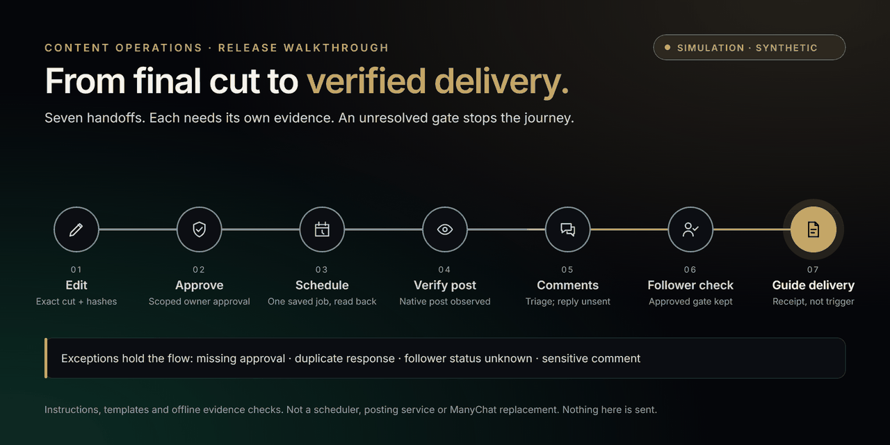

# From final cut to verified delivery

An original, self-contained **simulation** of the Content Operations release protocol. All records are synthetic. Nothing is scheduled, posted, replied to or sent.

**Open it locally.** Open [index.html](index.html) on GitHub, choose **Download raw file**, then open the downloaded file in a browser. GitHub shows HTML as source and cannot run it inline. The page has no install step, account, network request, font download or storage. Hosting it anywhere needs separate approval; it is not deployed.

[Conceptual animated preview (GIF)](../../assets/walkthrough-preview.gif) · [Scalable preview (SVG)](workflow-preview.svg)

The GIF and images are **conceptual artwork drawn from the same design**, not a screen recording of the browser page. The GIF plays once.

## What it shows

Seven stages: edit, approve, schedule, verify the post, comment triage, follower check and guide delivery. The page plays through once on its own when the browser allows motion, then stops. Previous, Play/Pause, Next and Reset are always available, and every stage can be selected directly. Any manual interaction pauses playback. With reduced motion requested, nothing advances on its own.

Four exception paths hold the journey at their gate:

| Path | Held at | Later stages |
| --- | --- | --- |
| Missing approval | 02 Approve | Locked |
| Duplicate response | 05 Comments | Locked |
| Sensitive comment | 05 Comments (escalated) | Locked |
| Follower unknown | 06 Follower check | Locked |

Selecting a locked stage, by click or arrow key, keeps you at the gate and explains why. It never shows an approved state past an unresolved gate. The public acknowledgement "Please check your DMs for the next step." appears only as a labelled, unsent example and is not treated as guide delivery. The final stage separates a fired trigger and an accepted send from bound delivery evidence.

The skill provides instructions, templates and offline evidence checks. It is not a scheduler, posting service, follower checker or ManyChat replacement, and this page exercises no live integration.

## Verification status

See [verification.json](verification.json) for the exact record.

- **Source checks (PASS):** `node docs/walkthrough/test-logic.cjs` runs the pure gating model for every path and target and checks labelling, controls, motion policy and self-containment. It is not browser QA.
- **Browser checks (reviewer-reported PASS, scoped; raw browser receipts unavailable for independent inspection):** on 1 November 2026 the page was served from `127.0.0.1` and opened in the Claude desktop app's built-in preview browser (Chromium). Checked: render at about 1024, 375 and 320 px with no horizontal overflow; autoplay advancing 1→7 then stopping; real clicks and arrow keys clamped at the gate with the locked-stage notice; visible focus ring; Shift+Tab and arrow-key path selection; no console errors; only the page itself requested; no cookies or storage. Some screenshots were captured while the pane was hidden, so state was confirmed through the live DOM.
- **NOT RUN:** reduced-motion runtime (the preview browser cannot emulate the preference), screen readers, Safari/Firefox and real mobile devices.

## Owner checklist (remaining)

1. Turn on your operating system's reduce-motion setting, reload the page and confirm nothing advances by itself and Play still works without transition motion.
2. With a screen reader, step through the stages and one exception path; confirm the stage name, held or locked status and the notice are announced.
3. Open the downloaded file in Safari or Firefox and on a phone; repeat one exception path and the full playback.

## Rebuilding the preview images

`python make-preview.py` rewrites `workflow-preview.svg`. `python make-preview.py --frames <new-folder>` also writes the conceptual frame SVGs. The PNG and GIF in `assets/` were rasterised from those SVGs in a local browser canvas and assembled with Pillow; neither step is needed to use the page.

Original vectors only; no logo, external assets or embedded fonts. Palette: Carbon, Pearl, Champagne, Data Blue and Emerald. DM Sans or Inter are used if already installed, with system fallbacks. The candidate licence and asset-rights notes apply; no trademark rights or provider endorsement are implied. This folder is documentation and is excluded from all four skill archives.
